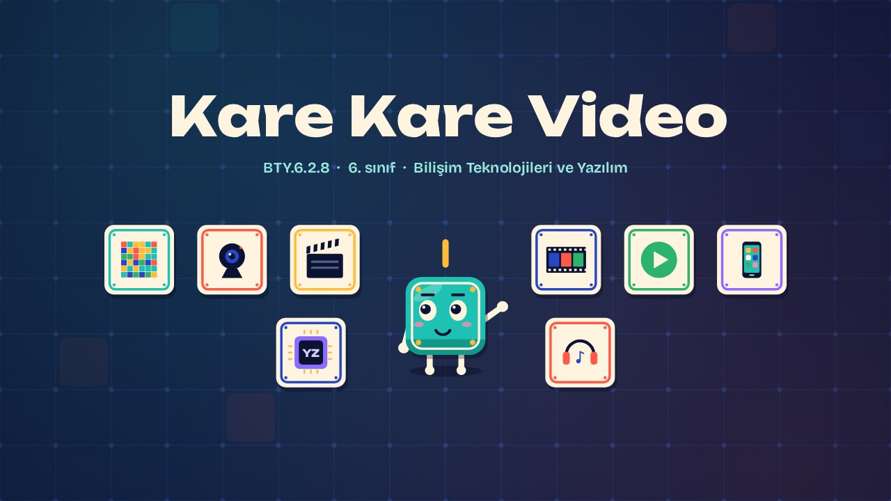
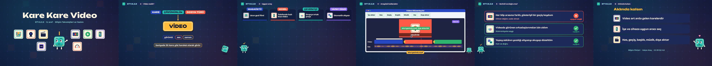

# Kare Kare Video · Frame by Frame

**▶ Tarayıcıda izleyin / Watch in the browser:** https://hakanatas.github.io/kare-kare-video/ 
**⬇ MP4 + altyazılar / MP4 + subtitles:** [Releases](https://github.com/hakanatas/kare-kare-video/releases) 
**✎ Kullanılan istem / The prompt behind it:** [PROMPT.md](PROMPT.md) 
**🎞 Bütün filmler / All films:** [Bilişim Filmleri](https://hakanatas.github.io/bilisim-filmleri/?sinif=6)

> **TR —** 6. sınıf Bilişim Teknolojileri ve Yazılım dersinin "Dijital Ürün Tasarımı ve Geliştirme" temasındaki BTY.6.2.8 öğrenme çıktısı için hazırlanmış, tamamen JavaScript ile çizilen 2,2 dakikalık animasyon; ses efektleri ve hafif fon müziği de kodla üretilir. Videonun art arda gösterilen resimlerden (karelerden) oluştuğu, piksel ve çözünürlük kavramlarıyla birlikte açıklanır; .mp4 gibi video dosyası türleri tanıtılır. İşe göre masaüstü, mobil, çevrim içi ya da yapay zekâ destekli video aracı seçilir. Bir video düzenleme programında klipler içe aktarılır, kesilir, geçiş eklenir, başlık yazılır, müzik eklenir, hız ayarlanır ve video dışa aktarılır. Son olarak video araçlarının kullanımı verimlilik ve etik açısından değerlendirilir. Altyazılar Türkçe, İngilizce ya da ikisi birlikte seçilebilir.

A 2.2-minute animation, with code-generated sound, for **6th-grade IT and Software** (Türkiye Yüzyılı Maarif Modeli). Video is explained as many still frames per second, with pixels and resolution; video files are introduced; desktop, mobile, online and AI tools are matched to jobs; Karo imports, cuts, adds transitions, a title, music and speed, and exports; and tool use is judged. The guide is **Karo**, a living glazed tile who never speaks: he tells the story with his face, his arms and the blinking cursor above his head.

## Öğrenme çıktısı · Learning outcome

MEB, Türkiye Yüzyılı Maarif Modeli, Bilişim Teknolojileri ve Yazılım Dersi Öğretim Programı, 6. sınıf, 2. tema "Dijital Ürün Tasarımı ve Geliştirme":

**BTY.6.2.8. Video düzenleme programlarından yararlanabilme**
- a) Video düzenleme programlarının temel özelliklerini tanır.
- b) Uygun video düzenleme programını belirler.
- c) Belirlenen video düzenleme programının arayüz özelliklerini kullanır.
- ç) Kullanılan video düzenleme programını kullanım alanları/verimliliği açısından değerlendirir.

## Sahneler · Scenes

| # | Zaman | Sahne | Ne oluyor | Çıktı |
|---|---|---|---|---|
| 1 | 0:00–0:16 | Giriş |  |  |
| 2 | 0:16–0:45 | Video nedir? | Kare, çözünürlük ve video dosyası türleri. | a |
| 3 | 0:45–1:08 | Uygun araç | İşe göre masaüstü, mobil, çevrim içi ya da yapay zekâ destekli video aracı. | b |
| 4 | 1:08–1:37 | Arayüzü kullanalım | İçe aktarma, kesme, geçiş, başlık, müzik, hız ve dışa aktarma. | c |
| 5 | 1:37–1:59 | Verimli ve doğru mu? | Video araçlarının kullanımı verimlilik ve etik açısından değerlendirilir. | ç |
| 6 | 1:59–2:14 | Aklında kalsın |  |  |

## Çalıştırma · Running it

- **Önizleme:** `index.html` dosyasına çift tıklayın (çevrim dışı da çalışır). Klavye: boşluk oynat/duraklat, ← → 3 sn, Home başa. Adrese `?altyazi=en`, `?bicim=vertical` ya da `?ses=0` eklenebilir.
- **MP4:** bir kez `npm install`, sonra `npm run export -- --format=both --captions=tr` (720p yatay ve dikey, sesli). Google Chrome yüklüyse Playwright onu kullanır (`channel: 'chrome'`); ffmpeg gerekir.
- **Altyazı ve seslendirme notları:** `npm run srt` → `out/kare-kare-video_tr.srt`, `_en.srt`, `_tr-en.srt`, `_seslendirme-notlari.txt`.
- **Sürüm dosyaları:** `npm run release` → `release/` klasöründe v1.0'ın 6 dosyası.
- **Yazı kontrolü:** `npm run check` yatay ve dikey düzende, üç altyazı seçeneğiyle üst üste binen, kenardan taşan ya da 720p'de 17 pikselden küçük kalan yazı arar.
- **Düzenleme:** senaryo (sahneler, altyazılar, seslendirme notları) `scenes/film.js` içindedir; değiştirince `npm run build` süreleri, `captions.js` ve `film.config.js` dosyalarını yeniden üretir. Sahne şablonları `src/kit/`, Karo `src/draw/karo.js`, ses `src/audio/synth.js`.

Her kare `renderFrame(t)` ile zamanın saf fonksiyonu olarak çizilir; rastgelelik tohumludur, MP4 ekran kaydı değil kare kare üretimdir. Ses de dosyadan çalınmaz: aynı olay listesinden hesaplanır. Yazı tipleri: Unbounded ve Bricolage Grotesque (SIL OFL 1.1), dosyaya gömülü.

## Lisans · License

**TR —** Bu film ve kodu [Creative Commons Atıf-GayriTicari 4.0 Uluslararası (CC BY-NC 4.0)](https://creativecommons.org/licenses/by-nc/4.0/deed.tr) lisansıyla paylaşılır. Ticari olmayan her amaçla (derste, okulda, eğitim materyalinde) kopyalayabilir, paylaşabilir ve değiştirebilirsiniz; ancak **kaynak göstermek zorunludur**: eser sahibinin adı ve bu deponun bağlantısı belirtilmeden kullanılamaz. Ticari kullanım (satış, ücretli ürün ya da yayın) için izin alınmalıdır.

**EN —** This film and its code are licensed under [Creative Commons Attribution-NonCommercial 4.0 International (CC BY-NC 4.0)](https://creativecommons.org/licenses/by-nc/4.0/). You may copy, share and adapt them for non-commercial purposes, but **attribution is required**: they may not be used without crediting the author and linking to this repository. Commercial use requires permission.

Atıf örneği / Required credit: *“Kare Kare Video”, Hakan Ataş, Bilişim Filmleri — https://github.com/hakanatas/kare-kare-video — CC BY-NC 4.0*
